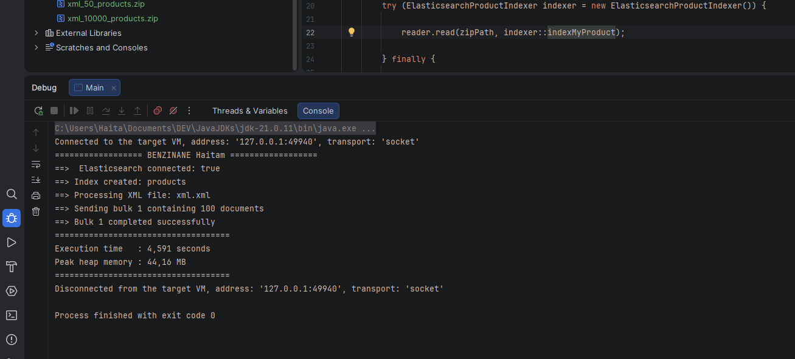
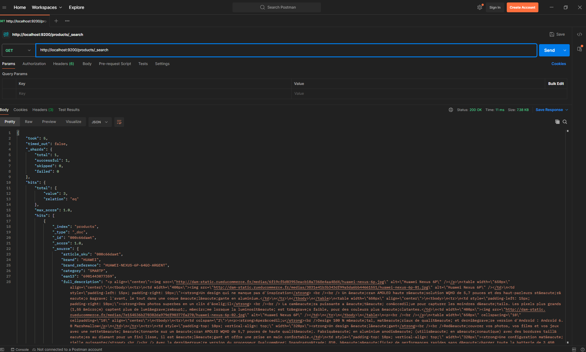
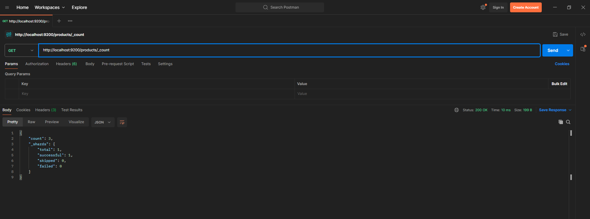

BENZINANE Haitam

LinkedIn: https://www.linkedin.com/in/haytambenz/

I’m open to your feedback and any suggestions for improving the project.
Thank you, Adelean, for this opportunity. I hope to meet your expectations.


# XML to Elasticsearch 
Ce projet a été réalisé dans le cadre d'un test technique.

L'objectif est de lire les produits présents dans un fichier XML contenu dans une archive ZIP, puis de les indexer dans **Elasticsearch 7.4.1**.

Même si le fichier fourni contient peu de produits, j'ai considéré l'hypothèse que le fichier XML puisse être très volumineux. J'ai donc choisi une approche en **streaming** afin de traiter les produits progressivement, sans charger l'ensemble du fichier en mémoire.

Pour l'indexation dans Elasticsearch, j'utilise également le **BulkProcessor** afin de regrouper les produits par lots et de limiter le nombre de requêtes envoyées.

---

## Technologies utilisées

- Java 21
- Maven
- Elasticsearch 7.4.1
- Elasticsearch Transport Client
- StAX (`XMLStreamReader`)
- `ZipInputStream`
- `BulkProcessor`
- Log4j2

---

## Fonctionnement

Le traitement suit le flux suivant :

```text
xml.zip
   |
   v
ZipInputStream
   |
   v
StAX XMLStreamReader
   |
   v
Lecture d'un produit
   |
   v
Map<String, Object>
   |
   v
BulkProcessor
   |
   v
Elasticsearch
```

Le fichier ZIP est parcouru avec `ZipInputStream`.

Lorsqu'un fichier XML est trouvé, il est directement transmis au parser StAX.

StAX fonctionne en streaming : le programme avance dans le XML événement par événement et ne construit qu'un seul produit à la fois.

Lorsqu'une balise `</product>` est atteinte, le produit est immédiatement transmis à l'indexeur Elasticsearch.


Il n'y a donc pas de liste contenant tous les produits du fichier en mémoire.


## Indexation Elasticsearch

### BulkProcessor

Je n'envoie pas une requête Elasticsearch indépendante pour chaque produit.

Chaque produit parsé est ajouté au `BulkProcessor`, qui regroupe les opérations avant de les envoyer à Elasticsearch.


Un bulk peut donc être envoyé lorsqu'une limite configurée est atteinte.

Les produits restants sont envoyés lors de la fermeture du `BulkProcessor`.

Le backoff exponentiel permet également de retenter progressivement une requête lorsque Elasticsearch est temporairement indisponible ou surchargé.

---

## Résultats des tests

J'ai effectué plusieurs tests avec différents nombres de produits.

| Nombre de produits | Temps d'exécution | Peak heap memory |
|-------------------:|------------------:|-----------------:|
| 3 | 2,781 s | 45,73 MB |
| 50 | 3,065 s | 44,65 MB |
| 100 | 4,591 s | 44,16 MB |

Le pic mémoire reste autour de **45 MB** entre 3 et 100 produits.

Cela correspond au comportement recherché : les produits sont traités progressivement et ne sont pas tous conservés simultanément en mémoire.

Pour les petits volumes, une partie importante du temps d'exécution correspond également au coût fixe lié à l'initialisation du client Elasticsearch, à la connexion et à la création ou vérification de l'index.

---

## Exemple d'exécution

Pour un fichier contenant 100 produits :

```text
================== BENZINANE Haitam ==================
==>  Elasticsearch connected: true
==> Index created: products
==> Processing XML file: xml.xml
==> Sending bulk 1 containing 100 documents
==> Bulk 1 completed successfully
====================================
Execution time   : 4,591 seconds
Peak heap memory : 44,16 MB
====================================

```

### Vérification de l'indexation dans Elasticsearch avec Postman



